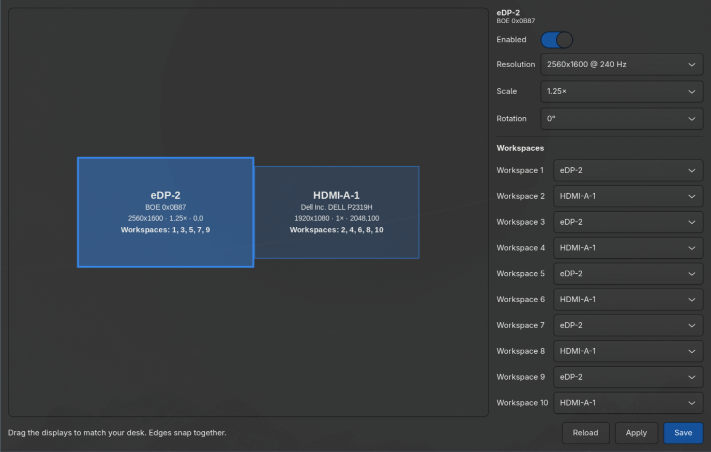

# hypr-displays

[](https://github.com/evertonlm/hypr-displays/actions/workflows/tests.yml)

A small graphical tool to arrange your monitors and assign workspaces in
[Hyprland](https://hypr.land), made for the **Lua config** (Hyprland 0.56+,
as used by [Omarchy](https://omarchy.org)).

Drag the screens to where they sit on your desk, pick which monitor each
workspace opens on, and save. No more hand-editing `monitors.lua`.



## Why

Tools like `nwg-displays` write the old `hyprland.conf` (hyprlang) format.
Hyprland's Lua config doesn't read those files, so the layout is lost on the
next reload. `hypr-displays` writes plain `hl.monitor(...)` and
`hl.workspace_rule(...)` calls instead.

## Features

- **Drag and drop** monitors on a canvas. Edges snap together (side by side,
  above/below, aligned or centered).
- **Per monitor:** enable/disable, resolution and refresh rate, scale, rotation.
- **Workspaces 1–10:** choose the monitor for each one. The canvas shows which
  workspaces live on each screen.
- **Warnings** for overlapping screens and for screens that don't touch any
  other (the mouse can't cross a gap).
- **Apply** changes only the running session, so you can try a layout first.
- **Save** writes the config, reloads Hyprland and moves open workspaces to
  their new monitors.
- It won't let you disable your last enabled monitor.

## Requirements

- Hyprland with Lua config (tested on 0.56.2)
- Python 3, PyGObject and GTK 4

On Arch / Omarchy:

```bash
sudo pacman -S python-gobject gtk4
```

## Install

```bash
git clone https://github.com/evertonlm/hypr-displays.git
cd hypr-displays
./install.sh          # copies to ~/.local/bin
# ./install.sh --link # symlink instead, if you want to hack on it
```

Uninstall with `./install.sh --uninstall`.

### Keybinding (optional)

In `~/.config/hypr/bindings.lua` (Omarchy):

```lua
-- SUPER+CTRL+D is Omarchy's monitor panel, so add SHIFT.
o.bind("SUPER + CTRL + SHIFT + D", "Displays", { launch = "hypr-displays" })
```

Plain Hyprland Lua:

```lua
hl.bind("SUPER + CTRL + SHIFT + D", hl.dsp.exec_cmd("hypr-displays"))
```

### Floating window (optional)

```lua
o.window({ class = "io.github.evertonlm.HyprDisplays" }, { float = true, center = true, size = { 1100, 700 } })
```

## How it saves

The app owns one block inside `~/.config/hypr/monitors.lua`:

```lua
-- BEGIN hypr-displays (generated by hypr-displays; edits inside this block are overwritten)
hl.monitor({ output = "HDMI-A-1", mode = "1920x1080@60", position = "0x0", scale = 1 })
hl.monitor({ output = "eDP-2", mode = "2560x1600@240", position = "160x1080", scale = 1.25 })
hl.workspace_rule({ workspace = "1", monitor = "eDP-2", default = true })
hl.workspace_rule({ workspace = "2", monitor = "HDMI-A-1", default = true })
...
-- END hypr-displays
```

- Everything outside the block is left alone.
- If the block doesn't exist yet, it's added at the end of the file.
  Remove any old `hl.monitor(...)` lines for the same outputs, so the two
  don't fight.
- The first workspace of each monitor is marked as its `default`.
- After saving, the app runs `hyprctl reload` and shows any config errors.

To write somewhere else, set `HYPR_DISPLAYS_CONFIG`:

```bash
HYPR_DISPLAYS_CONFIG=~/.config/hypr/displays.lua hypr-displays
```

## Limitations

- Only monitors Hyprland can see (`hyprctl monitors all`) are shown.
- Workspaces 1–10 only. Named and special workspaces aren't managed.
- No mirroring, VRR, bit depth or HDR settings yet.
- Layouts are not saved per set of monitors (e.g. "docked" vs. "laptop only").

## Development

```
hypr-displays            GTK 4 window and hyprctl calls
hypr_displays_core.py    layout logic: snapping, overlap checks, Lua output, config block (no GTK)
tests/                   unit tests (stdlib unittest, no extra packages)
```

Run the tests:

```bash
python3 -m unittest discover -s tests -v
```

They run without GTK or Hyprland, and also on every push through GitHub Actions.
New logic goes in `hypr_displays_core.py` with a test first.

## Contributing

Issues and pull requests are welcome. Use `./install.sh --link` to try your
changes, and make sure the tests pass.

## License

[MIT](LICENSE)
